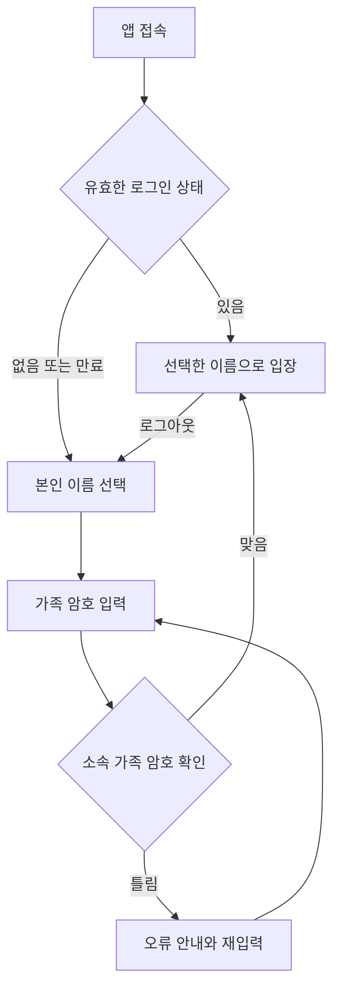

# 가족 선택과 고정 암호로 시작하는 칠순 여행

## 필수 연결 자료

- [PRODUCT.md](../../../PRODUCT.md) — 가족별 참여를 구분하고 모든 가족이 여행 준비에 참여한다는 제품 방향.
- [가족 로그인 결정](../../decisions/family-login.md) — 가족 단위 암호, 구성원 구분, Supabase 저장, 30일 로그인 유지.
- [UI 구성 원칙](../../decisions/ui-composition.md) 및 [DESIGN.md](../../../DESIGN.md) — 공통 UI 구성과 시각 언어의 읽기 경로.
- [용어](../../../GLOSSARY.md) — 가족 그룹과 가족 구성원의 구분.
- [승인된 화면](prototype.html) — 로그인 화면의 배치·문구·이미지·오류 표현. 2026-11-21 사용자가 화면을 확정했다.

## 사용자에게 보이는 결과

가족은 앱에 접속해 본인 이름을 선택하고 소속 가족의 네 자리 고정 암호를 입력한다. 로그인하면 선택한 이름으로 참여하며 같은 브라우저에서 30일 동안 다시 입력하지 않고 이용한다. 비밀번호를 새로 정하거나 바꾸는 절차는 없다.

## 승인된 범위

한 작업 단위로 가족 선택 화면, 가족별 암호 확인, 로그인 유지와 로그아웃, Supabase에 저장하는 가족·구성원·인증 관련 정보를 다룬다. 이번 PR의 산출물은 구현 계약과 화면 프로토타입이며 실제 인증 및 DB 연결은 후속 구현에서 이 계약을 충족해야 한다.

| 화면 그룹명 | 구성원 |
| --- | --- |
| 사랑하는 우리 어머니 | 이정희 |
| 아들래미 가족 | 김영욱, 류낭, 김재이, 김태이, 김채이 |
| 딸래미 가족 | 김고은, 강병용, 강한성, 강한결 |

암호는 사용자가 별도로 지정한 가족별 값 세 개를 그대로 사용한다. 실제 값은 이 문서·프로토타입·이미지·공개 이력에 기록하지 않는다. 앞자리의 0도 포함하는 네 자리 문자열이다.

## 화면과 흐름

로그인 화면의 확정된 문구:

- 상단: `이정희 여사님 칠순 기념 오사카 가족 여행`
- 제목: `70년산 명품엄마`
- 소개: `항공권 값은 냈다! 나머진 알지?`
- 폼 제목: `효도하러 왔니?`
- 입력 안내: `본인 선택 후 가족 암호 입력 하시오.`
- 암호 안내 직후: `아래 버튼을 눌러주세요.`를 진하고 굵게 표시하여 커스텀 문구 버튼을 누르는 동작을 안내한다.
- 입장 버튼: 이름을 선택하면 아래 문구로 즉시 바뀐다. 선택 전에는 `엄마! 잘탈게! ✈️`를 표시한다.

| 선택한 구성원 | 버튼 문구 |
| --- | --- |
| 이정희 | 내가 쏜다! 💸 |
| 김영욱, 김고은 | 효도는 현지에서! ✈️ |
| 류낭 | 어머님 충성! 🫡 |
| 김재이, 김태이, 강한성, 강한결 | 할머니 최고!! ❤️ |
| 강병용 | 사위는 공짜죠? 😎 |
| 김채이 | 할미 쪼아앙! 🥰 |

어머니는 파스텔풍 창작 캐릭터로 제목 옆에 표시하며, 오사카 풍경은 배경으로 사용한다. 실제 인물 사진을 재현한 초상이 아니다. 승인된 그림 원본은 [어머니 캐릭터](assets/premium-mom.png), [오사카 배경](assets/osaka-pastel.png)이다. 입력 영역의 가독성을 유지한다.

출발일은 2027-05-13이며 여행 일정은 2027-05-13부터 2027-05-16까지다. D-Day는 한국의 현재 달력 날짜를 기준으로 표시하고 열린 화면도 날짜가 바뀌면 갱신한다. 2026-11-21에는 `D-173`이다.

## 수용 기준

아래 기준은 후속 구현의 실제 브라우저 및 Supabase 연결로 검증한다. 프로토타입 체험으로 실제 인증이 구현됐다고 판단하지 않는다.

1. 로그인 상태가 없으면 위 세 그룹의 10명이 정확한 이름과 그룹으로 보이고 본인을 한 명 선택할 수 있다. 직접 이름 입력이나 회원가입은 요구하지 않는다.
2. 선택한 이름과 숫자 네 자리가 준비되기 전에는 입장할 수 없다. 암호는 기본적으로 가려지고 보기·숨기기를 전환할 수 있다.
3. 같은 그룹의 모든 구성원은 그 그룹에 지정된 암호로 로그인할 수 있다. 다른 그룹의 암호 또는 잘못된 암호로는 로그인할 수 없으며 안내 후 다시 입력할 수 있다. 앞자리 0을 보존한다.
4. 로그인 성공 직후 선택한 구성원이 표시되며 로그인 후 목적지로 이동한다. 가족 그룹만을 로그인 주체로 표시해서는 안 된다.
5. 로그인 후 새로고침·브라우저 재실행·재방문에도 최초 로그인 시각으로부터 30일 미만이면 같은 구성원으로 입장한다. 방문만으로 만료 시각을 늘리지 않는다.
6. 최초 로그인 후 30일이 지나면 다시 본인을 선택하고 암호를 입력해야 한다. 만료 상태를 안내하며, 로그인되지 않은 상태로 보호된 화면에 직접 입장할 수 없다.
7. 로그아웃하면 유지 기간이 남아 있어도 그 브라우저의 로그인 상태가 끝난다. 다른 구성원으로 입장하려면 다시 이름 선택과 가족 암호 확인을 거친다.
8. 가족·구성원 및 로그인에 필요한 정보는 Supabase에 저장되고 실제 저장 정보로 암호 확인과 구성원 구분이 이루어진다. 프로토타입의 고정 더미 확인만으로 대체하지 않는다.
9. 실제 가족 암호와 Supabase 비밀 키가 화면의 목록 응답·정적 파일·브라우저에 전달되는 소스에 포함되지 않는다. 인증 여부를 화면 선택 값만으로 판정하지 않는다.
10. 가족 정보를 불러오거나 로그인 확인을 하지 못하면 성공으로 처리하지 않는다. 재시도할 수 있는 안내를 표시하며 확인 중 중복 제출을 막는다.
11. 확정된 문구와 그림을 승인된 화면에 맞게 표시한다. 좁은 화면에서 가로 스크롤이나 그림과 입력 요소의 겹침 없이 이름 선택·암호 입력·입장이 가능하다.
12. 한국 날짜 기준 출발 D-Day가 정확하다. 2026-11-21은 `D-173`, 2026-11-22는 `D-172`, 출발 당일은 `D-Day`로 표시된다.

## 확정된 제약과 근거

가족별 공통 암호, 구성원 선택, 비밀번호 변경 생략, Supabase 사용, 30일 유지의 근거와 재검토 조건은 연결된 가족 로그인 결정 계약을 따른다. 제품 전체 정의는 PRODUCT.md에 유지한다.

공통 암호를 아는 사람은 같은 그룹의 다른 이름도 선택할 수 있다. 이는 개인별 신원 증명을 보장하는 서비스가 아닌 가족 내 참여 구분이라는 승인된 모델의 결과다.

## 가정 — 바꿀 수 있음

- 로그인 후 아직 여행 준비 본화면이 없으면, 선택한 이름과 로그아웃을 보여 주는 최소 입장 화면을 사용한다. 프로토타입의 `로그인 완료` 화면은 이 연결 확인을 위한 참고이며 여행 대시보드 설계가 아니다.
- 출발일이 지난 뒤에는 `D+N`으로 표시한다.
- 암호를 잊으면 기존에 전달받은 가족 암호를 가족에게 확인한다. 별도 복구 절차는 제공하지 않는다.
- 이미지 분위기와 배치는 승인된 프로토타입을 따르며 검토용 시스템 글꼴은 구현 시 프로젝트 글꼴로 연결한다.

## 범위 밖과 이유

- 체크리스트·의견 공유·AI 여행 정보·여행 대시보드 — 로그인 다음의 별도 제품 기능이다.
- 회원가입·이메일 인증·Google 로그인·비밀번호 변경/재설정·가족 관리 화면 — 등록된 가족의 고정 암호 로그인 요청에 포함되지 않는다.
- 인증 서비스 일반화·요청되지 않은 보안 하드닝·성능 방어 — 학습 프로젝트의 검증 예산을 따른다.

## 미뤄 둔 결정

없음. 여행 본화면을 새로 설계하는 요청이 생기면 최소 입장 화면의 대체 목적지를 해당 작업에서 정한다.

## 남은 위험

- 네 자리 공통 암호는 개인별 강한 신원 증명을 제공하지 않는다. 같은 그룹 구성원의 다른 이름 선택이 가능하다.
- Supabase SDK는 아직 프로젝트에 설치되지 않았고 연결된 프로젝트 설정도 검증하지 않았다. 이메일/전화 기반 기본 로그인과 네 자리 가족 암호를 동일한 것으로 가정하지 말고, 구현 시 실제 서비스 설정 및 공식 문서에 맞춰 요구 동작을 검증한다.
- 프로토타입은 모든 가족에 체험용 더미 암호 `1234`를 사용한다. 실제 DB 조회·암호 검증·30일 세션은 구현되어 있지 않다.

## 기술 context 확인

사용자가 Supabase를 선택했다. `add-stack-context`로 공식 [Agent Skills 문서](https://supabase.com/docs/guides/ai-tools/ai-skills)를 확인하고 `supabase/agent-skills`의 `supabase`와 `supabase-postgres-best-practices`를 Codex와 Claude Code에 실제 디렉터리 복사로 설치했다. 두 복사본의 동일성과 symlink 부재를 확인했다. AGENTS.md의 Supabase 공식 문서 절이 작업 시작 시 공식 changelog와 관련 문서를 재조회하도록 안내한다. 갱신에는 프로젝트의 `--copy` 설치 정책을 적용한다.

[공식 Password Auth](https://supabase.com/docs/guides/auth/passwords) 및 [암호 설정 소스](https://github.com/supabase/auth/blob/master/internal/conf/configuration.go)를 확인했다. 기본 이메일/전화 인증이 이름 선택 UI와 곧바로 같은 인증 수단이라는 결론은 내리지 않았다. SDK가 미설치이고 외부 프로젝트를 변경하지 않아 설치 버전과 실제 프로젝트에 대한 인증 실험은 후속 구현에서 수행한다.

## Setup before implementation

- 사용할 Supabase Cloud 프로젝트와 해당 프로젝트의 DB·인증 설정을 조회하고 필요한 정보를 저장할 접근 수단 — 가족·구성원·로그인 정보 저장에 필요 — 완료 조건: 앱 밖의 Supabase 콘솔이나 직접 API 조회에서 대상 프로젝트가 확인되고 허용된 조회가 성공한다.
- 사용자 지정 가족 암호 세 개를 공개 Git 이력 밖의 안전한 실행 설정으로 준비 — 정확한 가족별 고정 암호 적용에 필요 — 완료 조건: 각 그룹에 대응하는 네 자리 값이 비공개 설정에 있으며 앞자리 0이 보존된 것을 앱과 독립적으로 확인한다. 실제 값은 문서에 기록하지 않는다.

## Post-release check

None.

## 프로토타입 검토 기록

- 단일 HTML로 그림을 포함하여 인터넷 연결 없이 화면을 열 수 있다. 상단 control은 검토 도구이며 실제 제품에 포함하지 않는다.
- 이름 선택, 암호 보기·숨기기, 더미 암호 오류 후 재입력, 입장, 로그아웃과 연결 오류 재시도를 브라우저에서 확인했다.
- 390/768/full 폭의 가로 넘침과 이미지 표시를 확인했다. 한국 날짜의 자정 전후 및 출발 당일 D-Day 계산을 확인했다.
- 실제 앱 인증이나 Supabase 데이터 저장에 대한 검증 결과가 아니다.
